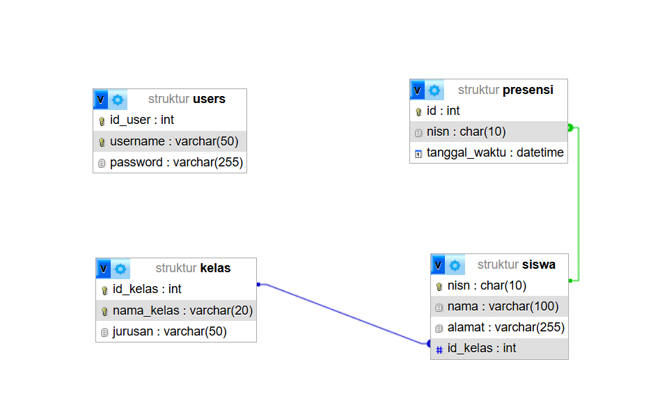
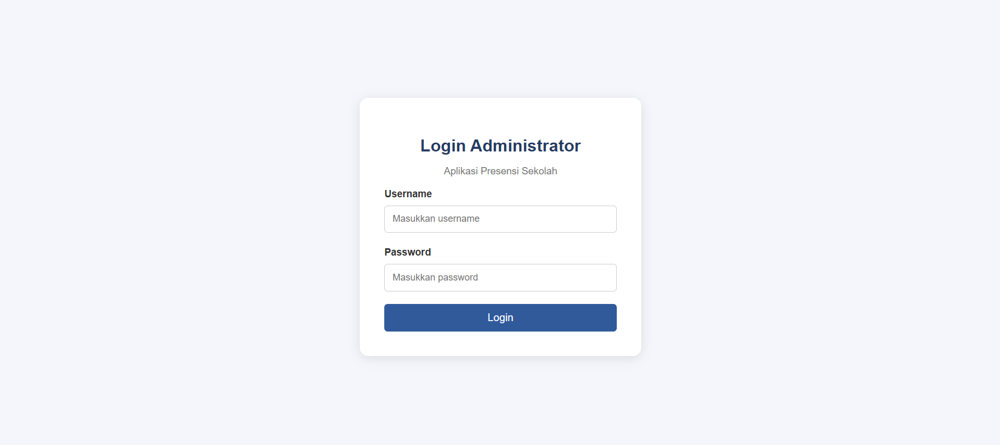
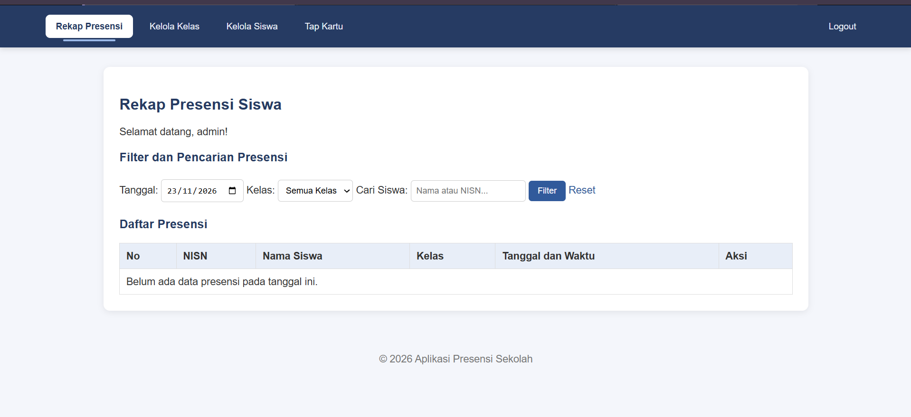
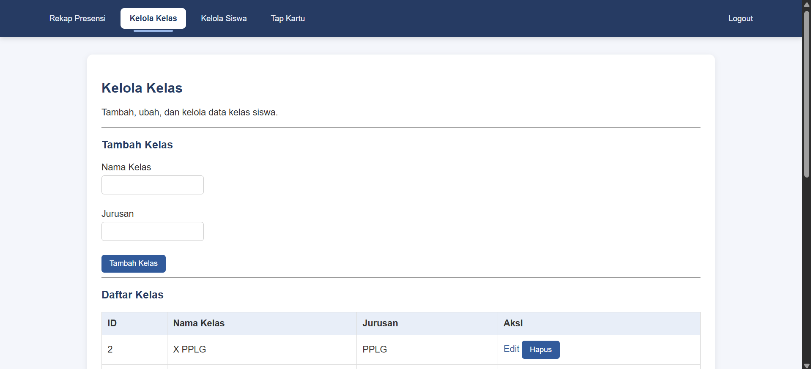
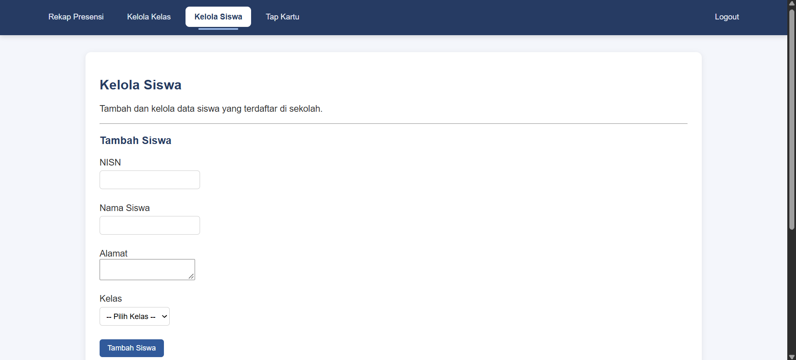
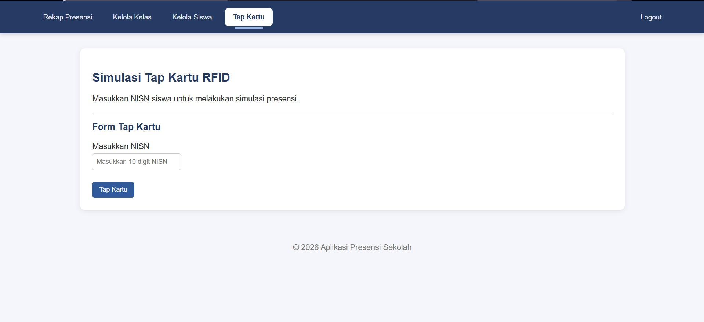

# Aplikasi Presensi Sekolah

## Deskripsi
Aplikasi Presensi Sekolah adalah aplikasi berbasis web untuk membantu administrator mengelola data kelas, data siswa, dan presensi siswa.

## Teknologi
- PHP Native
- PDO
- MariaDB
- HTML dan CSS
- Laragon

## Fitur
- Login dan logout administrator
- CRUD data kelas
- CRUD data siswa
- Simulasi tap kartu berdasarkan NISN
- Rekap presensi harian
- Pencarian siswa berdasarkan nama atau NISN
- Pencarian dan filter data presensi

## Cara Instalasi
1. Install Laragon.
2. Salin folder aplikasi ke dalam folder `www`.
3. Jalankan Apache dan MySQL melalui Laragon.
4. Buka phpMyAdmin.
5. Buat database bernama `struktur`.
6. Buat tabel sesuai struktur database aplikasi.
7. Sesuaikan konfigurasi koneksi database di `config/Database.php`.
8. Buka aplikasi melalui `http://localhost/Aplikasi-Presensi-Sekolah/login.php`.

## Akun Demo
- Username: [admin]
- Password: [admin2511]

## Struktur Database
Database: `struktur`

- `kelas`: menyimpan data kelas dan jurusan.
- `siswa`: menyimpan data siswa.
- `presensi`: menyimpan riwayat presensi siswa.
- `users`: menyimpan akun administrator.

## Entity Relationship Diagram (ERD)

## Screenshot Aplikasi

### Login

### Rekap Presensi

### Kelola Kelas

### Kelola Siswa

### Simulasi Tap Kartu

## Hasil Pengujian

| No. | Skenario Pengujian | Hasil Aktual | Status |
|---|---|---|---|
| 1 | Login dengan password salah | [hasil/1.png] | [Berhasil] |
| 2 | Buka halaman tanpa login | [hasil/2.1.png_hasil/2.2.png] | [Berhasil] |
| 3 | Tambah siswa dengan NISN 9 digit | [hasil/3.png] | [Berhasil] |
| 4 | Tambah siswa dengan NISN yang sudah ada | [hasil/4.png] | [Berhasil] |
| 5 | Tap dengan NISN tidak terdaftar | [hasil/5.png] | [Berhasil] |
| 6 | Tap dengan NISN valid | [hasil/6.png] | [Berhasil] |
| 7 | Hapus kelas yang masih memiliki siswa | [hasil/7.png] | [Berhasil] |
| 8 | Cari siswa berdasarkan sebagian nama | [hasil/8.png] | [Berhasil] |

## Pengembang
Nama: Najwa Anjelina  
Kelas: XI PPLG  
Sekolah: SMKTI Airlangga
